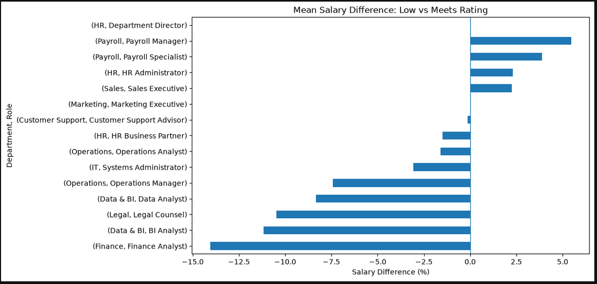
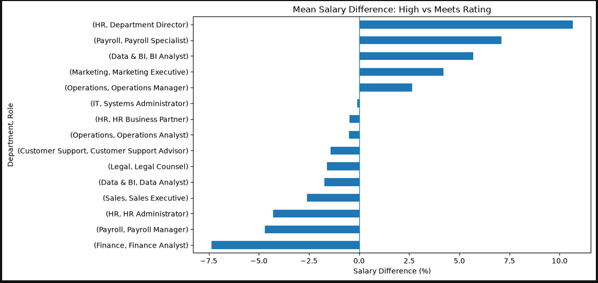
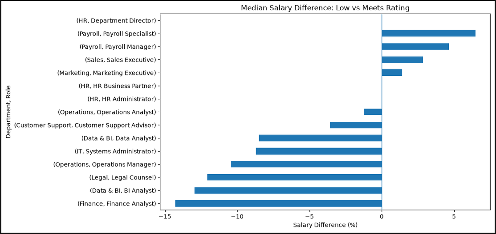
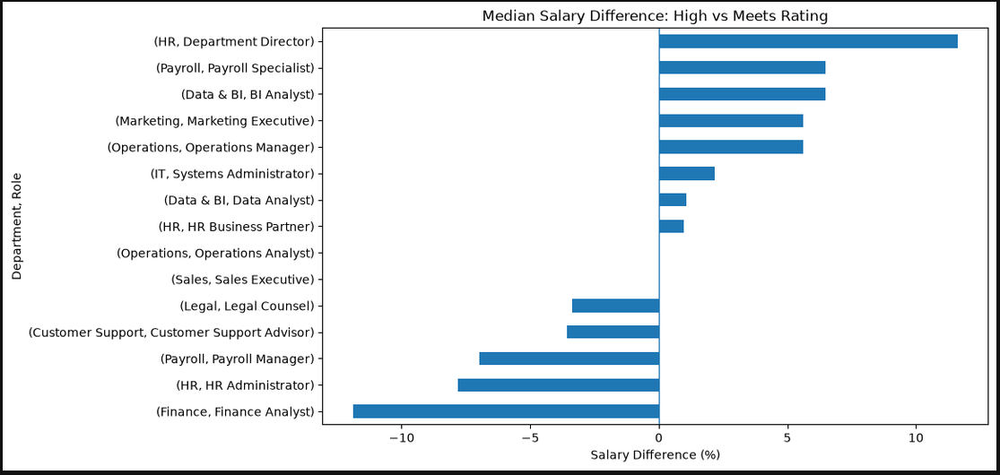
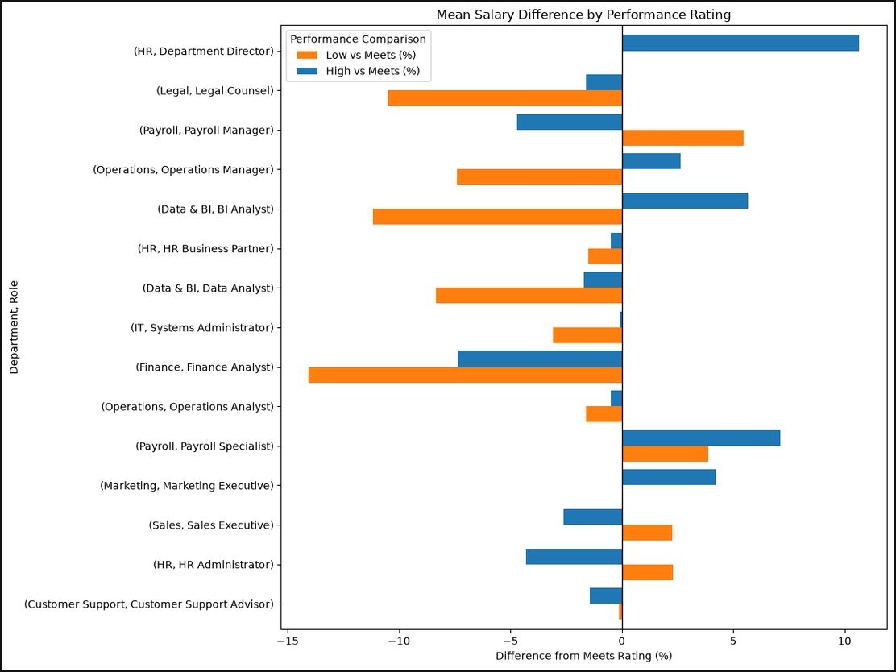

# AMJS Inc.

AMJS Inc. is a fictional company of 1,000 employees. The company database was created using an LLM, which generated nine CSV files (ensuring compatibility with Google BigQuery) covering the following datasets:

- Employees
- Departments
- Compensation
- Performance
- Payroll runs
- Payroll entries
- Job roles
- Locations
- Time attendance

# An Important Note

**The data used in this project is AI-generated, and does not represent the workforce or pay data of any real company.**

# Business Questions

**1. How is workforce composition influencing payroll costs at AMJS Inc., and which departments should management investigate to better understand changes in workforce expenditure?**

**2. To what extent were employee performance ratings associated with compensation in 2024, and did that relationship differ across departments?**

I aim to answer these questions using a variety of the technical tools below. Multiple analytical tools may be used for each question to give a rounded and broad view of the company and the context for the answers.

# Findings

## Question 1

### Gross pay

Following exploratory analysis, gross pay appears to be consistent with headcount growth - Total gross pay has increased by 12.19%, and headcount grew in the same period by 12.16%, leaving a percentage point difference of 0.03%. Though, it is important to understand that the comparison between the first and latest pay runs does not account for fluctuations between those two points. To view a more detailed timeline change comparison, please view the Power BI file in the repo, and the screenshot below for a rough idea.

### Other pay types

We should examine other pay types to assess their impact as well as gross pay - the biggest of the two being overtime pay.

Over the same period, total pay — comprising gross pay, overtime pay and bonus pay — increased by 12.08% (£339,538.22). Overtime pay increased by 8.84% (£8,269.11), accounting for approximately 2.44% of the total increase. This suggests that overtime was not a major contributor to the overall increase in total pay. Bonus pay comprised only £16.9k across the whole measured period, so did not represent a significant enough portion of total pay to warrant measurement.

For in-depth results, please see the Exploratory Analysis & Findings notebook in the Question 1 folder.

## Question 2

Following exploratory analysis, there appears to be little to no evidence that compensation was associated with employee performance in 2024.

Initial findings suggested many inconsistencies in pay structure. However, I realised that this was a limitation of my analysis - I was only grouping by departments and performance ratings to find average salaries (sql/02_departments_mean_median_values). The problem lies in that within each department there are sometimes multiple roles with varying levels of seniority. Therefore, pulling averages from across multiple roles and providing one figure for each department is not representative of pay structure. To fix this, I joined the Job Role table in the SQL query, and pulled it through to be grouped by job role as well (sql/03-depts_roles_mean_median_values).

Now that I had fair pay comparison across grouped roles, I was ready to begin analysis. I created pivots grouped by department, role, and performance rating, which showed percentage mean and median salary deviation for 'Low' and 'High' performance ratings, using 'Meets' as a baseline for comparison. From there, I was able to create bar charts using the matplotlib Python library, showing outliers and anomalies in a visual method. See below and in 'images' folder.

### Mean - Low vs Meets

### Mean - High vs Meets

### Median - Low vs Meets

### Median - High vs Meets

### Mean - Combined Chart

From these charts, we can see that every department has at least one role whose pay structure is either inconsistent or even inversely correlated with performance in a descriptive sense. There were exactly 0 departments that suggested a positive correlation with performance. There were individual roles that suggested this, however (BI Analyst and Operations Manager), and if there were to be further investigation into the creation of a merit-based pay structure, then these two roles should be examined to inform the design.

An important point to make here is that in the case of some roles within departments, the sample size was quite small. A pivot with employee count can be found within the Python notebook in the folder.

# Tools Used

- SQL (BigQuery)
- Python
- Pandas
- Matplotlib
- Power BI
- DAX

# Data Cleaning and Validation

Thankfully, due to the database being generated by an LLM, the generated files were relatively free of expected human error in input. Data cleaning mostly involved joins and data validation, ensuring that the correct information is pulling through and being prioritised in the correct order. Where applicable, details of data cleaning and validation required will be present in notebook markdown or SQL comments.
