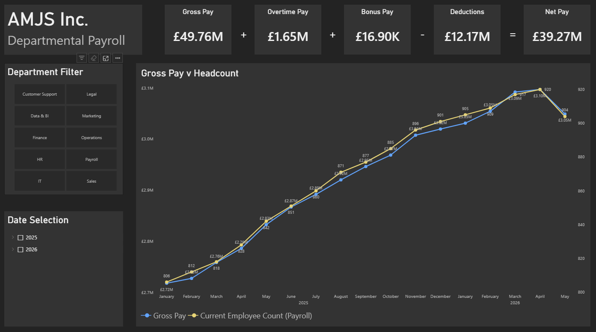

# AMJS Inc.

AMJS Inc. is a fictional company of 1,000 employees. The company database was created using an LLM, which generated nine CSV files (ensuring compatibility with Google BigQuery) covering the following datasets:

- Employees
- Departments
- Compensation
- Performance
- Payroll runs
- Payroll entries
- Job roles
- Locations
- Time attendance

## Business Questions

1. How is workforce composition influencing payroll costs at AMJS Inc., and which departments should management investigate to better understand changes in workforce expenditure?
2. To what extent were employee performance ratings associated with compensation in 2024, and did that relationship differ across departments?

I aim to answer these questions using a variety of the technical tools below. Multiple analytical tools may be used for each question to give a rounded and broad view of the company and the context for the answers.

## Findings

## Question 1

Following exploratory analysis, gross pay appears to be consistent with headcount growth, though it is important to understand that the comparison between the first and latest pay runs does not account for fluctuations between those two points. To view a more detailed timeline change comparison, please view the Power BI file in the repo.

Over the same period, total pay — comprising gross pay, overtime pay and bonus pay — increased by 12.08% (£339,538.22). Overtime pay increased by 8.84% (£8,269.11), accounting for approximately 2.44% of the total increase. This suggests that overtime was not a major contributor to the overall increase in total pay. Bonus pay comprised only £16.9k across the whole measured period, so did not represent a significant enough portion of total pay to warrant measurement.

## Question 2

## Tools Used

- SQL (BigQuery)
- Python
- Pandas
- Power BI
- DAX

## Data Cleaning and Validation

Thankfully, due to the database being generated by an LLM, the generated files were relatively free of expected human error in input. Data cleaning mostly involved joins and data validation, ensuring that the correct information is pulling through and being prioritised in the correct order. Where applicable, details of data cleaning and validation required will be present in notebook markdown or SQL comments.
